<!-- README.md is generated from README.Rmd. Please edit this file. -->
<!-- Figures are produced by the package itself: Rscript data-raw/make_figures.R -->

```{r, include = FALSE}
knitr::opts_chunk$set(collapse = TRUE, comment = "#>", eval = FALSE)
```

<p align="center">
  
</p>

<h1 align="center">caagro</h1>
<p align="center"><b>Ciência Aplicada em Análises do Agro</b><br>
Plataforma de análise estatística para experimentação agrícola — em R e em aplicativos Shiny</p>

<p align="center">

= 4.1">


</p>

---

O **caagro** reúne, em um único pacote, os métodos estatísticos mais usados na
experimentação agrícola: ANOVA em DIC, DBC e fatoriais, comparações múltiplas,
diagnóstico de resíduos, regressão linear, não linear e binomial, testes não
paramétricos, intervalos de confiança, análises multivariadas e exploratórias.

Tudo é feito em um único aplicativo, aberto com `run_app()`, **sem
escrever código**. Cada análise pode ser exportada como script R
reprodutível.

<p align="center">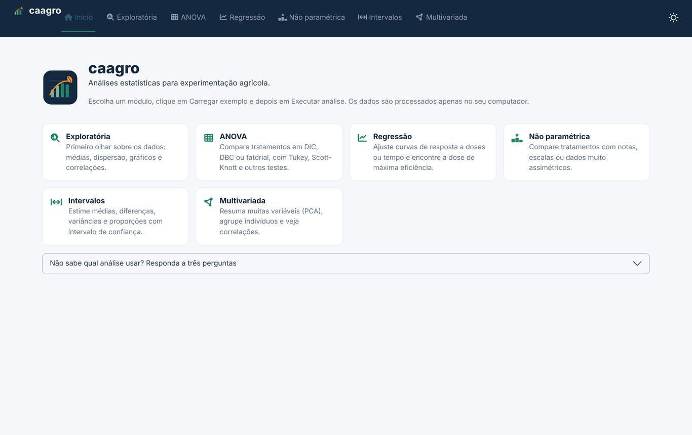</p>

## Destaques

| | |
|---|---|
| **Rigor estatístico** | Modelos corretos para cada delineamento (o DBC nunca é analisado como DIC), ANOVA convencional de Fisher como padrão (somas de quadrados sequenciais, como `aov`; tipos II/III opcionais), médias marginais estimadas para dados desbalanceados, comparação com implementações de referência em testes automatizados. |
| **Transparência** | Nenhuma observação é removida automaticamente; exclusões são explícitas e registradas. Falhas de convergência são relatadas, nunca mascaradas. |
| **Didática** | Cada resultado traz três níveis: *Resultado*, *Interpretação* e *Cuidados* (ocultáveis no “modo científico”). Assistente de análise baseado em regras transparentes. |
| **Gráficos editoriais** | Um único editor gráfico para todos os módulos, cinco temas, exportação re-renderizada em PNG, TIFF, SVG e PDF (300–1200 dpi). |
| **Reprodutibilidade** | Script R, configuração JSON, versões e sementes exportados junto com relatórios Excel e HTML/Word. |
| **Local e privado** | Tudo roda no seu computador; sem conta, telemetria ou envio de dados. |

## Instalação

```{r}
install.packages(c("shiny", "bslib", "ggplot2", "DT", "openxlsx", "readxl",
                   "jsonlite", "mvtnorm", "cluster", "rlang"))
install.packages("caagro_1.2.0.tar.gz", repos = NULL, type = "source")
install.packages(c("ragg", "svglite", "rmarkdown"))   # recomendados
```

## Uso

O caagro tem uma única função:

```{r}
library(caagro)
run_app()                # página inicial com todos os módulos
run_app("anova")         # ou abra direto um módulo
```

Módulos: `"anova"`, `"regressao"`, `"nao_parametrica"`, `"intervalos"`,
`"multivariada"` e `"exploratoria"`.

Em todos os módulos: **Carregar exemplo** (ou importar planilha) → escolher
as variáveis → **Executar análise**. Os resultados aparecem em **Análise**
(resumo, tabela principal, comparações e pressupostos); **Diagnósticos**,
**Gráficos** e **Exportação** ficam em abas próprias. Opções avançadas ficam
recolhidas.

| Módulo | Exemplo incluído | Método padrão |
|---|---|---|
| ANOVA | Produtividade de soja (DIC), ensaio em DBC, fatorial 3 x 3 | ANOVA de Fisher + Tukey a 5% |
| Regressão | Resposta à dose; germinação x dose (binomial) | Linear e quadrático |
| Não paramétrica | Notas de severidade (1 a 9) | Kruskal-Wallis + Dunn (Holm) |
| Intervalos | Peso de plantas (dados reais) | IC 95% por tratamento |
| Multivariada | 36 genótipos, 6 caracteres | PCA padronizada |
| Exploratória | Altura de plantas | Estatística descritiva |

<p align="center">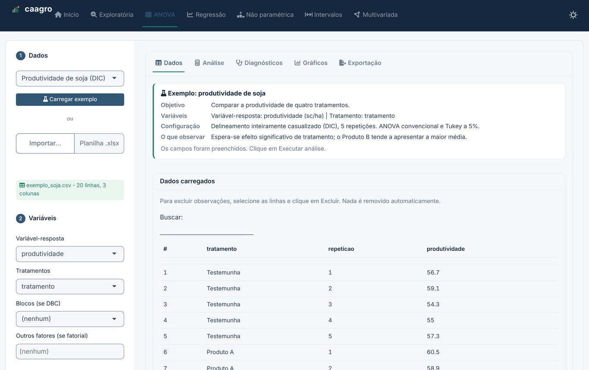</p>
<p align="center">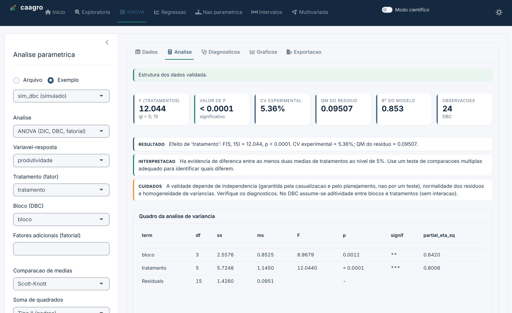</p>

## O que cada módulo faz

**ANOVA.** Análise de variância convencional de Fisher em DIC, DBC e
fatorial; Tukey, Scott-Knott, SNK, LSD (com DMS), Dunnett, Bonferroni e
Holm; seção **Pressupostos da ANOVA** com Shapiro-Wilk e Bartlett; em
fatoriais com interação significativa, comparação dentro de cada nível do
outro fator. ANOVA de Welch e teste t como alternativas.

<p align="center">
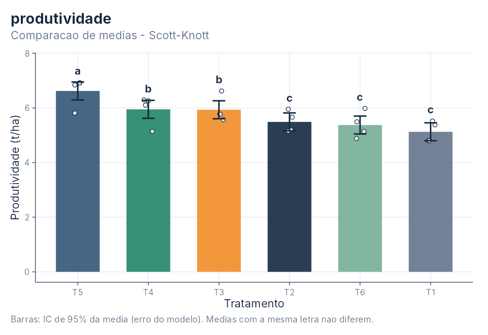
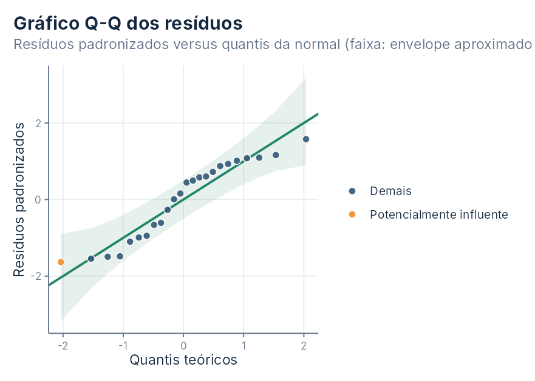
</p>

**Regressão.** Linear, quadrática, cúbica, logarítmica, exponencial,
potência, logística (3 e 4 parâmetros), Gompertz, Michaelis-Menten,
assintótica, Mitscherlich, log-logística, linear-platô e binomial; faixas de
confiança e de predição; comparação por AICc; várias curvas com teste de
igualdade; dose de máxima eficiência técnica, dose econômica e ED50.

<p align="center">
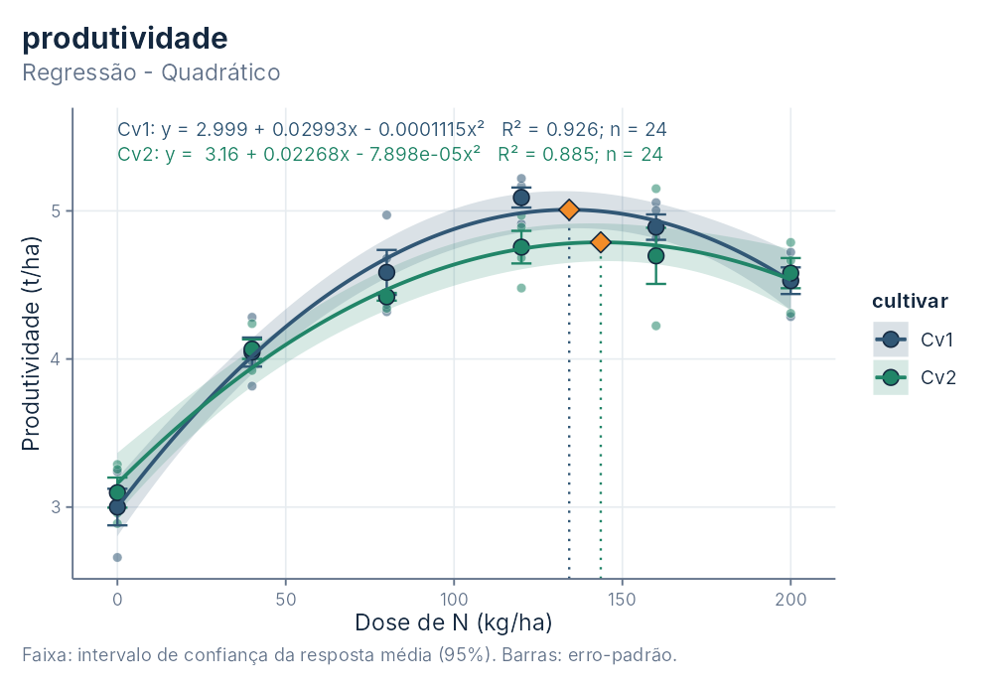
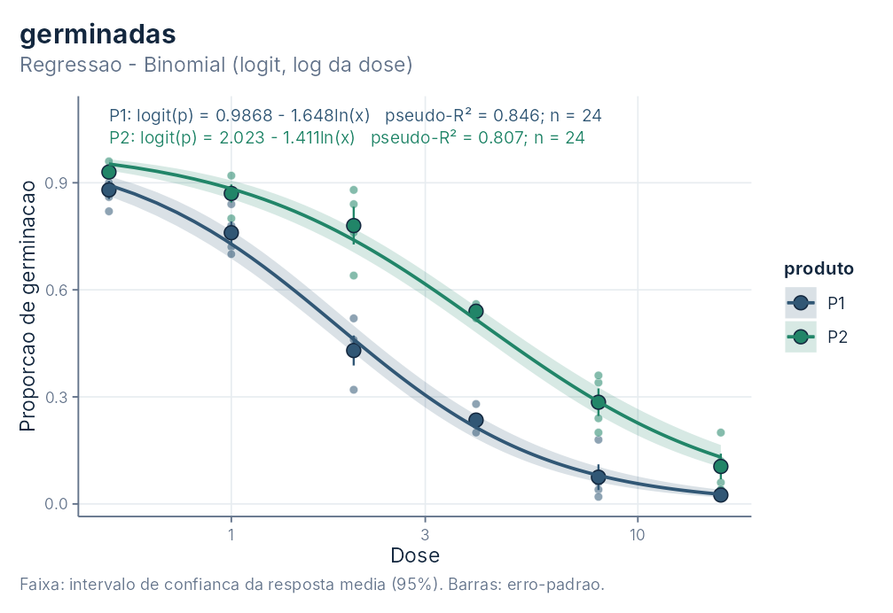
</p>

**Não paramétrica.** Kruskal-Wallis, Friedman, mediana de Mood,
Mann-Whitney, Wilcoxon pareado, sinais e permutação, com Dunn ou Conover.

**Intervalos de confiança.** Médias por tratamento, diferenças (variâncias
iguais ou Welch), variância, desvio-padrão, proporção e bootstrap (BCa).

**Multivariada.** PCA (biplot, círculo de correlações, contribuições),
agrupamento hierárquico, k-means e matriz de correlações.

<p align="center">
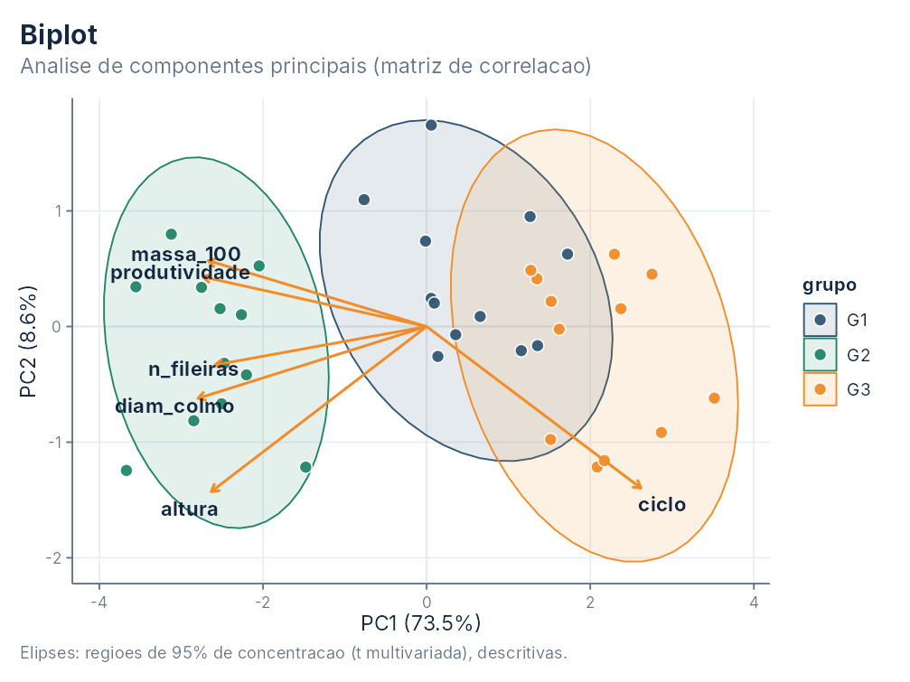
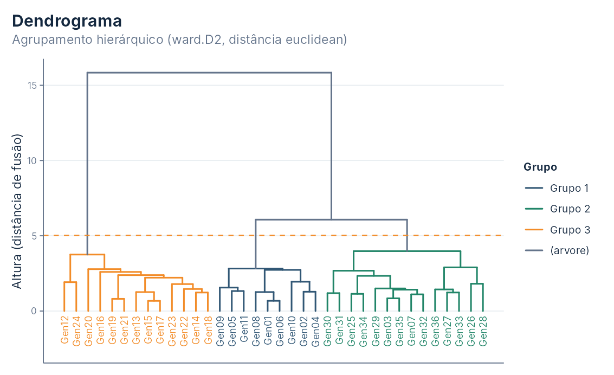
</p>

**Gráficos e exportação.** Editor gráfico com cinco temas, títulos,
eixos, unidades, cores e legenda; exportação em PNG, TIFF, SVG e PDF
(300–1200 dpi). Resultados em Excel, relatório HTML/Word e script R
reprodutível.

<p align="center">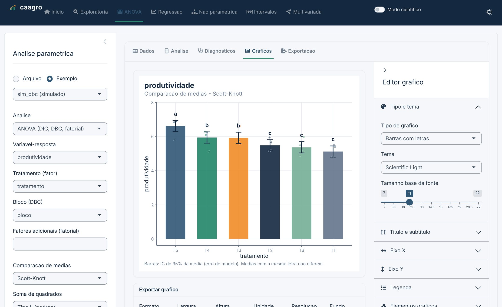</p>
<p align="center">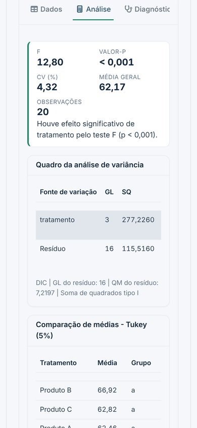</p>

## Validação

Os cálculos são conferidos por testes automatizados contra implementações de
referência do R: `aov`/`lm`/`glm`, `TukeyHSD`, `shapiro.test`,
`bartlett.test`, `car::Anova`, `car::leveneTest`, `emmeans`, `rstatix`,
`kruskal.test`, `friedman.test`, `prcomp`, `hclust` e `boot`. SNK e
Scott-Knott são verificados pelo cálculo manual das fórmulas originais.
Os testes também simulam o uso do aplicativo com cada exemplo.

## Roadmap

- Modelos mistos (blocos aleatórios, parcelas subdivididas) com `nlme`/`lme4`.
- Skillings-Mack para blocos incompletos; PCoA, NMDS e PERMANOVA.
- Modelos de contagem (Poisson, binomial negativa) e quasibinomial.
- Testes de interface ponta a ponta com `shinytest2` e integração contínua (hoje os servidores dos módulos são testados com `shiny::testServer()`).
- Modo exploratório interativo com `plotly` (opcional).

## Como citar

```{r}
citation("caagro")
```

Valasco dos Santos, W.; Garcia Coutinho, W. B. (2025). *caagro: Applied
Statistics for Agricultural Experimentation in a 'shiny' Application*. Pacote
R, versão 1.2.0.

## Licença

MIT © Wilhan Valasco dos Santos e Walter Baida Garcia Coutinho. Veja `LICENSE`.

## Autoria

**Wilhan Valasco dos Santos**<sup>1,\*</sup> · **Walter Baida Garcia Coutinho**<sup>2</sup>

<sup>1</sup> Instituto Federal Goiano, Campus Rio Verde, Rodovia Sul Goiana, Km 01,
Zona Rural, 75901-970, Rio Verde, Goiás, Brasil.
ORCID: <https://orcid.org/0000-0002-6533-2407>

<sup>2</sup> Departamento de Estatística, Universidade Federal de Viçosa (UFV),
Avenida Peter Henry Rolfs, s/n, Campus Universitário, 36570-900, Viçosa,
Minas Gerais, Brasil. ORCID: <https://orcid.org/0000-0002-9894-6122>.
E-mail: walterbgc1@gmail.com

<sup>\*</sup> Autor correspondente: Wilhan Valasco dos Santos.
E-mail: wilhanvalasco@hotmail.com

Os conjuntos `sim_*` são **simulados** e servem apenas para ilustração;
`PlantGrowth` é um conjunto de dados real do pacote `datasets` do R.
