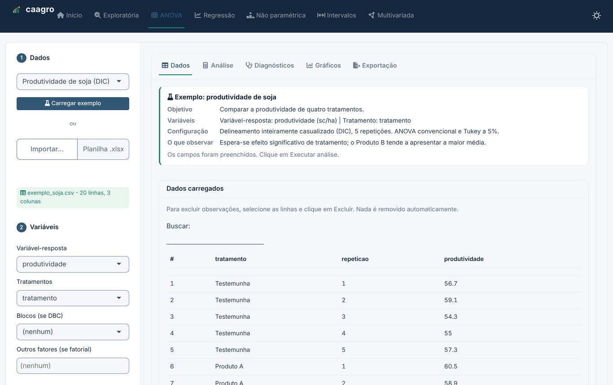
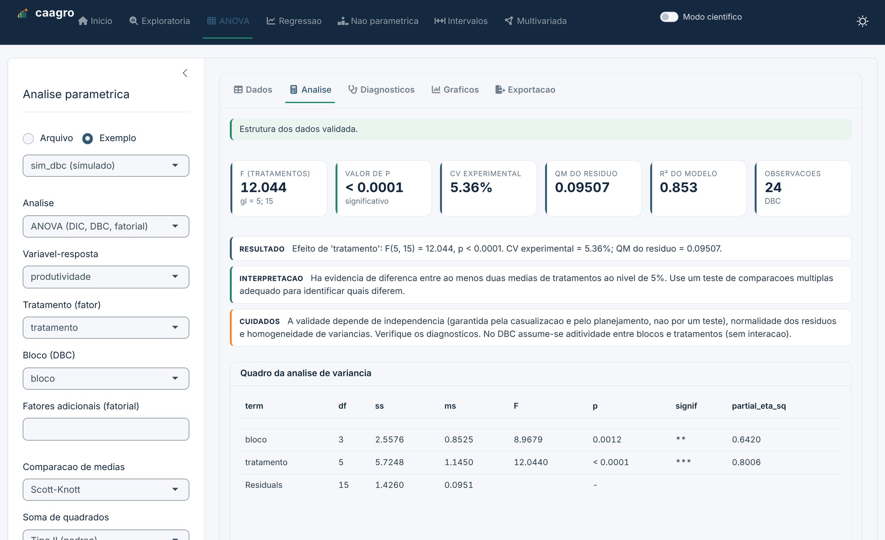
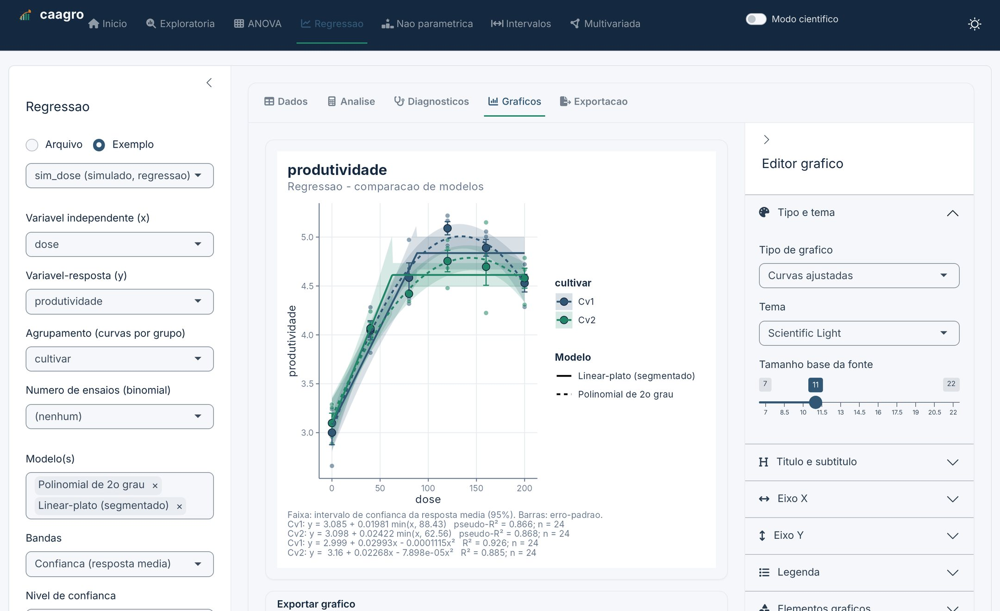
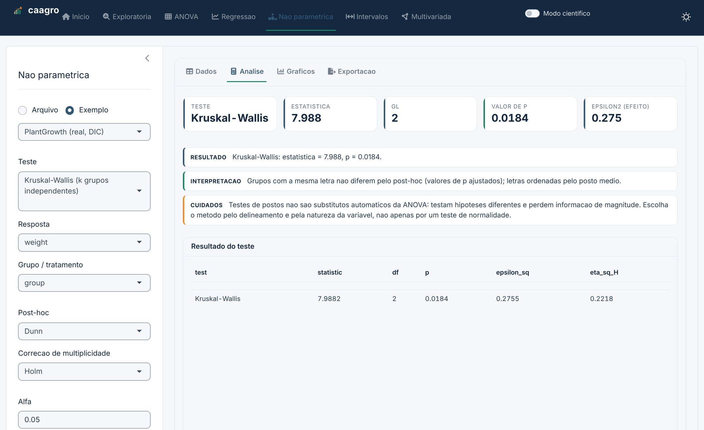
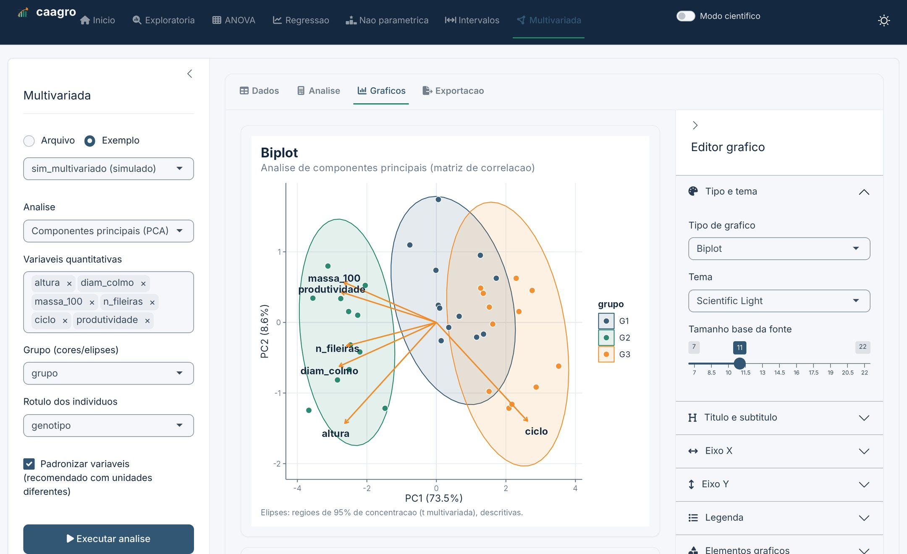
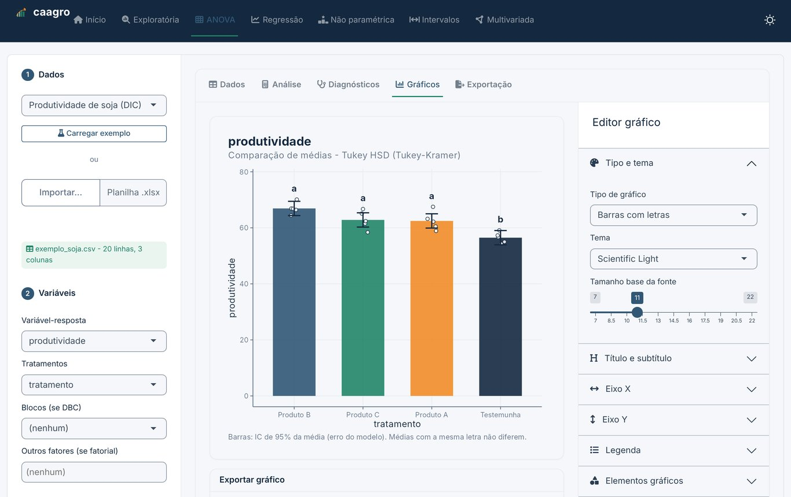
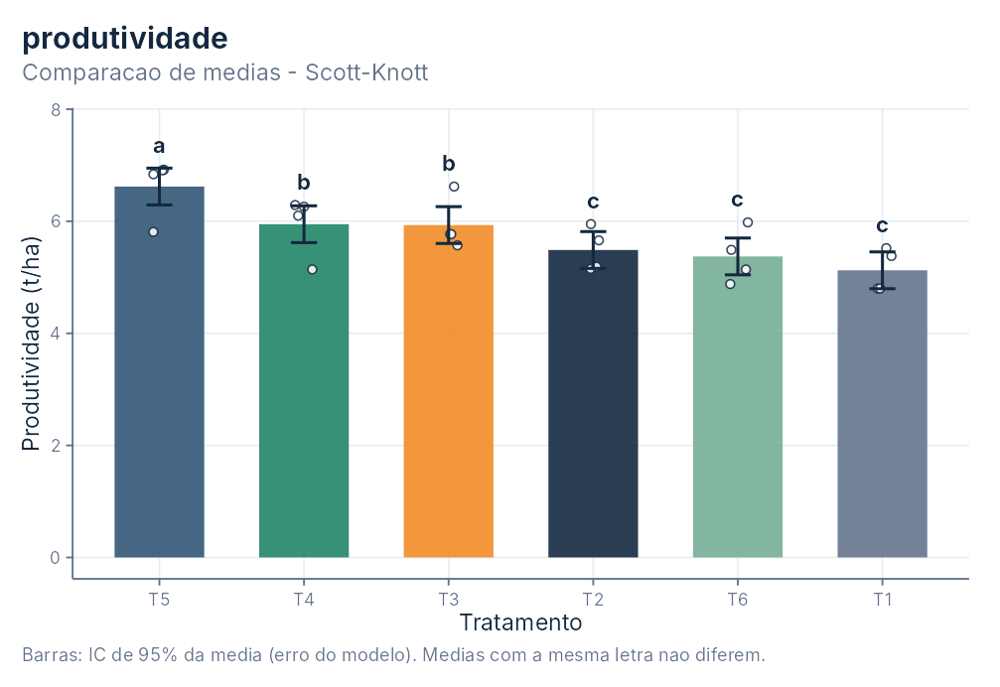
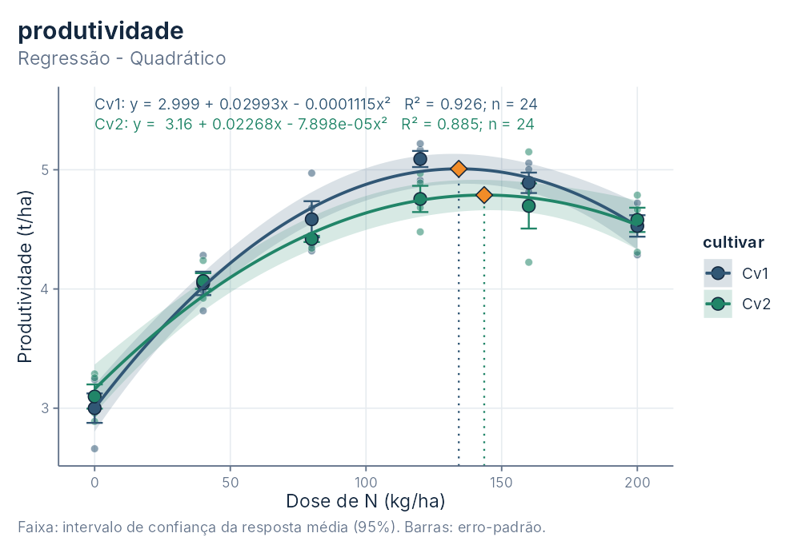

<!-- README.md é gerado a partir de README.Rmd. Edite este arquivo. -->
<!-- Figuras produzidas pelo próprio pacote: Rscript data-raw/make_figures.R -->
<p align="center">

</p>
<h1 align="center">
caagro
</h1>
<p align="center">
<b>Ciência Aplicada em Análises do Agro</b><br> Aplicativo de análise
estatística para experimentação agrícola
</p>
<p align="center">

= 4.1">

</p>

------------------------------------------------------------------------

O **caagro** reúne, em um único aplicativo, as análises estatísticas
mais usadas na experimentação agrícola: análise de variância (DIC, DBC e
fatorial), comparação de médias, pressupostos, regressão, testes não
paramétricos, intervalos de confiança, análises multivariadas e
exploratórias. Tudo é feito **sem escrever código**, com um único
comando: `run_app()`.

Este documento é o **manual de uso completo** do pacote.

## Sumário

1.  [Instalação](#1-instalação)
2.  [Como abrir o aplicativo](#2-como-abrir-o-aplicativo)
3.  [Fluxo de uma análise](#3-fluxo-de-uma-análise)
4.  [Como organizar a planilha](#4-como-organizar-a-planilha)
5.  [Aba Dados](#5-aba-dados)
6.  [Módulo ANOVA](#6-módulo-anova)
7.  [Módulo Regressão](#7-módulo-regressão)
8.  [Módulo Não paramétrica](#8-módulo-não-paramétrica)
9.  [Módulo Intervalos](#9-módulo-intervalos)
10. [Módulo Multivariada](#10-módulo-multivariada)
11. [Módulo Exploratória](#11-módulo-exploratória)
12. [Gráficos: editor e exportação](#12-gráficos-editor-e-exportação)
13. [Exportação de resultados](#13-exportação-de-resultados)
14. [Reprodutibilidade (script R)](#14-reprodutibilidade-script-r)
15. [Como interpretar os resultados](#15-como-interpretar-os-resultados)
16. [Problemas comuns](#16-problemas-comuns)
17. [Métodos e validação](#17-métodos-e-validação)
18. [Como citar](#18-como-citar)
19. [Autoria](#19-autoria)

## 1. Instalação

No R (versão 4.1 ou superior):

``` r
# dependências
install.packages(c("shiny", "bslib", "ggplot2", "DT", "openxlsx", "readxl",
                   "jsonlite", "mvtnorm", "cluster", "rlang"))
# recomendados: exportação de figuras em alta qualidade e relatório em Word
install.packages(c("ragg", "svglite", "rmarkdown"))

# pacote caagro (arquivo .tar.gz)
install.packages("caagro_1.2.1.tar.gz", repos = NULL, type = "source")

# ou diretamente do GitHub
# install.packages("remotes")
remotes::install_github("wilhanvalasco/caagro")
```

## 2. Como abrir o aplicativo

``` r
library(caagro)
run_app()                       # página inicial com todos os módulos
```

Também é possível abrir um módulo diretamente:

| Comando                      | Módulo                                      |
|------------------------------|---------------------------------------------|
| `run_app("anova")`           | Análise de variância e comparação de médias |
| `run_app("regressao")`       | Regressão e curvas de resposta              |
| `run_app("nao_parametrica")` | Testes não paramétricos                     |
| `run_app("intervalos")`      | Intervalos de confiança                     |
| `run_app("multivariada")`    | PCA, agrupamentos e correlações             |
| `run_app("exploratoria")`    | Estatística descritiva                      |

O aplicativo abre no navegador. Todos os cálculos são feitos no seu
computador; nenhum dado é enviado para a internet. Para encerrar, feche
a aba do navegador e pressione `Esc` (ou o botão *Stop*) no R.

Na página inicial, o painel **“Não sabe qual análise usar?”** sugere o
método a partir de três perguntas: o objetivo, o tipo de
variável-resposta e o tipo de experimento.

<p align="center">

</p>

## 3. Fluxo de uma análise

Todos os módulos funcionam da mesma forma. A coluna da esquerda tem os
passos numerados:

1.  **Dados** – clique em **Carregar exemplo** para testar, ou em
    **Importar…** para abrir a sua planilha.
2.  **Variáveis** – escolha a variável-resposta, os tratamentos e, se
    houver, blocos e outros fatores.
3.  **Método** – escolha o teste ou o modelo (o padrão já é adequado
    para a maioria dos casos).
4.  Clique em **Executar análise**.

Os resultados ficam organizados em abas:

| Aba              | Conteúdo                                                               |
|------------------|------------------------------------------------------------------------|
| **Dados**        | Descrição do exemplo, tabela dos dados, exclusão de linhas, conversões |
| **Análise**      | Resumo, tabela principal, comparações e pressupostos                   |
| **Diagnósticos** | Gráficos de resíduos e testes complementares (ANOVA e regressão)       |
| **Gráficos**     | Gráfico da análise, editor de aparência e exportação da figura         |
| **Exportação**   | Planilha Excel, relatório, script R e configurações                    |

Configurações menos usadas ficam em **Opções avançadas**, recolhidas.
Textos explicativos ficam em painéis recolhidos (**Interpretação e
cuidados**). No celular, os controles aparecem acima dos resultados.

<p align="center">

</p>

## 4. Como organizar a planilha

Use o **formato longo**: **uma linha por parcela** (unidade
experimental) e **uma coluna por variável**.

| bloco | tratamento | produtividade |
|-------|------------|---------------|
| B1    | T1         | 58,4          |
| B1    | T2         | 63,1          |
| B2    | T1         | 57,9          |
| …     | …          | …             |

Recomendações:

- Primeira linha com os nomes das colunas, sem células mescladas.
- Tratamentos e blocos podem ser textos (`T1`, `Testemunha`) ou números.
- Doses (para regressão) devem ser numéricas.
- Células vazias são tratadas como valores ausentes e informadas.
- Arquivos aceitos: `.xlsx`, `.xls`, `.csv` (separador `;` ou `,`) e
  `.txt`. Separador e decimal são detectados automaticamente; se
  necessário, ajuste em **Opções de leitura**. Em planilhas Excel com
  várias abas, escolha a aba em **Planilha**.

Se cada repetição estiver em uma coluna (formato largo: `R1`, `R2`,
`R3`), use **Dados \> Converter formato largo em longo**.

## 5. Aba Dados

- **Exemplo**: quando um exemplo é carregado, aparece um quadro com o
  objetivo, as variáveis, a configuração e o que observar no resultado.
- **Dados carregados**: tabela com busca. Para retirar observações (por
  exemplo, um erro de digitação confirmado), selecione as linhas e
  clique em **Excluir selecionadas**. As exclusões ficam registradas no
  resultado e no script. **Restaurar todas** desfaz. **Baixar dados
  (.csv)** salva a tabela.
- **Estrutura das variáveis**: tipo, valores ausentes e valores
  distintos.
- **Converter tipo ou renomear coluna**: transforma uma coluna em
  numérica, qualitativa ou texto; renomeia colunas (o arquivo original
  não é alterado).
- **Converter formato largo em longo**.
- **Valores potencialmente atípicos**: sinaliza valores fora de 1,5 × a
  amplitude interquartil, por grupo. **Nada é removido
  automaticamente.**

## 6. Módulo ANOVA

**Quando usar:** comparar médias de tratamentos qualitativos
(cultivares, produtos, manejos) com resposta contínua (produtividade,
altura, massa).

**Exemplos incluídos:** produtividade de soja (DIC, Tukey), seis
tratamentos em blocos (DBC, Scott-Knott) e fatorial 3 × 3 cultivar ×
adubação em blocos.

**Campos:**

| Campo                        | O que informar                                                                     |
|------------------------------|------------------------------------------------------------------------------------|
| Variável-resposta            | Coluna numérica medida (ex.: produtividade)                                        |
| Tratamentos                  | Coluna que identifica os tratamentos                                               |
| Blocos (se DBC)              | Coluna dos blocos. Deixe “(nenhum)” para DIC                                       |
| Outros fatores (se fatorial) | Segundo (e terceiro) fator do fatorial                                             |
| Comparação de médias         | Tukey, Scott-Knott, SNK, LSD de Fisher (DMS), Dunnett, Bonferroni, Holm ou Nenhuma |
| Nível de significância       | 5% (padrão), 1% ou 10%                                                             |
| Tratamento controle          | Aparece quando o teste é Dunnett                                                   |
| LSD protegido                | Aparece no LSD: só declara diferenças se o teste F for significativo               |

O delineamento é definido pelos campos preenchidos: sem blocos =
**DIC**; com blocos = **DBC**; com outros fatores = **fatorial** (com ou
sem blocos). Dados com coluna de blocos nunca são analisados como DIC.

**Opções avançadas:**

- **Método**: ANOVA convencional de Fisher (padrão); ANOVA de Welch,
  quando as variâncias são claramente diferentes (somente DIC,
  comparações por Games-Howell); teste t para dois grupos (Welch,
  Student ou pareado).
- **Soma de quadrados**: tipo I sequencial (padrão, igual ao `aov` do
  R); tipos II e III para fatoriais desbalanceados. Com dados
  balanceados os três coincidem.

**Resultados (aba Análise):**

1.  **Resumo**: F, valor-p, CV (%), média geral, número de observações e
    uma frase de interpretação.
2.  **Quadro da análise de variância**: Fonte de variação, GL, SQ, QM, F
    e valor-p; abaixo, delineamento, GL e QM do resíduo e tipo de soma
    de quadrados.
3.  **Comparação de médias**: Tratamento, Média e Grupo (letras). Médias
    com a mesma letra não diferem. A DMS é informada para Tukey e LSD
    com repetições iguais. No Dunnett não há letras: cada tratamento
    aparece como “difere” ou “não difere do controle”. Em **Comparações
    par a par** estão as diferenças, erros-padrão, intervalos e
    valores-p de cada par.
4.  **Pressupostos da ANOVA**: Shapiro-Wilk (normalidade dos resíduos) e
    Bartlett (homogeneidade das variâncias), com estatística, GL,
    valor-p e interpretação. Em fatoriais, Bartlett compara as
    combinações de tratamentos.
5.  **Atenção**: avisos relevantes (dados desbalanceados, observações
    influentes, pressupostos violados).

**Fatoriais:** quando a interação é significativa, o aplicativo compara
os níveis do primeiro fator **dentro de cada nível do segundo**
(desdobramento) e informa isso no resumo.

**Aba Diagnósticos:** gráfico Q-Q dos resíduos, resíduos × valores
ajustados, testes robustos de homogeneidade (Levene, Brown-Forsythe,
Fligner-Killeen), observações potencialmente influentes (distância de
Cook) e gráficos de escala-locação.

<p align="center">

</p>

**Qual teste de comparação escolher?**

| Teste             | Característica                                                                        |
|-------------------|---------------------------------------------------------------------------------------|
| Tukey             | Compara todos os pares controlando o erro do conjunto de comparações. Escolha padrão. |
| Scott-Knott       | Separa as médias em grupos sem sobreposição de letras. Útil com muitos tratamentos.   |
| SNK               | Mais poder que Tukey, mas não controla o erro do conjunto com mais de 3 médias.       |
| LSD de Fisher     | Mais liberal; use protegido (após F significativo).                                   |
| Dunnett           | Compara cada tratamento apenas com um controle.                                       |
| Bonferroni / Holm | Testes t par a par com correção para múltiplas comparações.                           |

## 7. Módulo Regressão

**Quando usar:** a variável explicativa é quantitativa (doses, tempo,
temperatura) e o interesse é a forma da resposta.

**Exemplos incluídos:** resposta da produtividade a doses de nitrogênio
em duas cultivares; germinação de sementes sob doses de herbicida
(binomial).

**Campos:**

| Campo                          | O que informar                                                      |
|--------------------------------|---------------------------------------------------------------------|
| Variável independente (x)      | Dose, tempo etc. (numérica)                                         |
| Variável dependente (y)        | Resposta medida                                                     |
| Uma curva por grupo            | Opcional: ajusta uma curva para cada cultivar, produto etc.         |
| Total de ensaios (só binomial) | Para dados do tipo “sucessos em n” (ex.: germinadas em 50 sementes) |
| Modelos                        | Um ou vários modelos para comparar                                  |

**Modelos disponíveis:** linear, quadrático, cúbico, logarítmico,
exponencial, potência, logístico (3 e 4 parâmetros), Gompertz,
Michaelis-Menten, assintótico, Mitscherlich, log-logístico
(dose-resposta), linear-platô, binomial (logit) e binomial em função do
log da dose.

**Opções avançadas:** tipo de faixa no gráfico (intervalo de confiança
da média ou de predição), nível de confiança, método das faixas em
modelos não lineares (delta ou bootstrap), semente, ajuste sobre
observações individuais (recomendado) ou sobre médias por dose
(comportamento da versão antiga) e razão de preços insumo/produto (para
a dose econômica).

**Resultados:** resumo com o melhor modelo pelo AICc; equações
ajustadas; comparação de modelos (R² ou pseudo-R², R² ajustado, RMSE,
AICc, Δ AICc); teste de igualdade das curvas entre grupos; grandezas
agronômicas (dose de máxima eficiência técnica e resposta máxima no
quadrático, dose econômica, dose crítica do linear-platô, ED50);
coeficientes com erros-padrão e intervalos. A aba Diagnósticos mostra
resíduos e a convergência dos ajustes.

> Não escolha o modelo apenas pelo maior R². Prefira o menor AICc entre
> modelos plausíveis e confira os resíduos. Não extrapole além das doses
> estudadas.

<p align="center">

</p>

## 8. Módulo Não paramétrica

**Quando usar:** notas e escalas (severidade, preferência), dados muito
assimétricos ou com valores extremos em que a ANOVA não é adequada.

**Exemplo incluído:** notas de severidade (escala de 1 a 9) de cinco
tratamentos.

| Teste                     | Situação                                                                |
|---------------------------|-------------------------------------------------------------------------|
| Kruskal-Wallis            | Três ou mais grupos independentes (equivale ao DIC)                     |
| Friedman                  | Tratamentos em blocos completos (um valor por tratamento em cada bloco) |
| Mediana de Mood           | Compara a proporção de valores acima da mediana geral                   |
| Mann-Whitney              | Dois grupos independentes                                               |
| Wilcoxon pareado / Sinais | Dois tratamentos avaliados na mesma unidade                             |
| Permutação                | Alternativa exata baseada em reamostragem                               |

Após Kruskal-Wallis ou Friedman, as comparações par a par (Dunn, Conover
ou Wilcoxon, com correção de Holm por padrão) geram as letras da tabela
**Medianas e postos por tratamento**.

<p align="center">

</p>

## 9. Módulo Intervalos

**Quando usar:** estimar a precisão de médias, diferenças, variâncias ou
proporções.

| Opção                                         | Descrição                                                     |
|-----------------------------------------------|---------------------------------------------------------------|
| Média de cada tratamento                      | Um intervalo por tratamento (variância combinada ou separada) |
| Média (uma amostra)                           | Intervalo t para a média                                      |
| Diferença entre 2 médias                      | Welch (variâncias diferentes) ou variâncias iguais            |
| Diferença pareada                             | Mesma unidade medida duas vezes                               |
| Variância, desvio-padrão, razão de variâncias | Intervalos qui-quadrado e F                                   |
| Proporção                                     | Wilson (padrão), exato ou Wald                                |
| Mediana (bootstrap)                           | Intervalo por reamostragem (BCa)                              |

> A sobreposição de intervalos individuais **não** é um teste de
> diferença entre tratamentos. Para isso use a ANOVA ou o intervalo da
> diferença.

## 10. Módulo Multivariada

**Quando usar:** muitas variáveis medidas nos mesmos indivíduos
(genótipos, áreas, amostras).

- **Componentes principais (PCA)**: variância explicada, cargas,
  correlações das variáveis com os componentes, contribuições; gráficos
  scree, biplot, escores, cargas, círculo de correlações e
  contribuições.
- **Agrupamento hierárquico**: dendrograma com corte em *k* grupos;
  distância e ligação configuráveis (Ward.D2 exige distância
  euclidiana); correlação cofenética.
- **K-means**: grupos, silhueta e método do cotovelo; semente
  registrada.
- **Matriz de correlação**: Pearson, Spearman ou Kendall, com correção
  para múltiplos testes.

Com variáveis em unidades diferentes, mantenha **Padronizar variáveis**
marcado.

<p align="center">

</p>

## 11. Módulo Exploratória

Estatísticas descritivas por variável e por grupo (n, ausentes, média,
mediana, mínimo, máximo, desvio-padrão, erro-padrão, CV, amplitude
interquartil, assimetria e curtose), frequências das variáveis
qualitativas, gráfico de dispersão e matriz de correlações. Os
resultados são atualizados automaticamente. Use este módulo antes de
qualquer análise para encontrar erros de digitação e valores extremos.

## 12. Gráficos: editor e exportação

Na aba **Gráficos** de cada módulo há o gráfico da análise e, à direita,
o **Editor gráfico**:

| Seção              | O que ajustar                                                                                                                                        |
|--------------------|------------------------------------------------------------------------------------------------------------------------------------------------------|
| Tipo e tema        | Tipo de gráfico (barras com letras, pontos, boxplot, curvas, biplot…), tema e tamanho da fonte                                                       |
| Título e subtítulo | Textos, tamanho, cor e alinhamento                                                                                                                   |
| Eixo X / Eixo Y    | Título, **unidade**, mínimo, máximo, intervalo entre marcas, casas decimais, rotação, tamanho e escala (linear, log10, raiz)                         |
| Legenda            | Exibir, posição, colunas, título, ordem dos grupos (`A; B; C`) e nomes (`T1=Testemunha; T2=Produto`)                                                 |
| Elementos gráficos | Tamanho e formato dos pontos, linhas, transparência, larguras das barras e barras de erro, cores (`#315775; #218568`), letras, valores e observações |
| Curvas (regressão) | Faixas, médias por dose, tipo de barra de erro, posição das equações e métricas exibidas, dose ótima                                                 |
| Estilos            | Restaurar padrão, copiar e aplicar estilo em outro gráfico, salvar e carregar estilo (`.json`), ver o código R                                       |

Temas: *Scientific Light* (padrão), *Scientific Minimal*, *Publication
Black & White*, *Scientific Dark* e *caagro Corporate*. **Todos os
gráficos têm fundo transparente**, no aplicativo e na exportação, para
serem colocados sobre qualquer fundo de slide ou documento.

**Exportar gráfico:** formato (PNG, TIFF, SVG ou PDF), resolução (150 a
1200 dpi), fundo (transparente por padrão, ou branco), largura, altura,
unidade (cm, mm, polegadas) e nome do arquivo. A figura é desenhada
novamente no tamanho final, sem perda de qualidade.

<p align="center">

</p>

## 13. Exportação de resultados

Na aba **Exportação**:

- **Planilha Excel**: dados originais, dados utilizados, estatística
  descritiva, todas as tabelas de resultados (com cabeçalhos em
  português) e uma aba de metodologia e parâmetros.
- **Relatório científico**: HTML (não depende de outros programas), Word
  (`.docx`, exige o Pandoc, instalado com o RStudio) ou PDF (exige
  Pandoc e um gerador de PDF). Versões completa ou resumida, com título
  e autores. Inclui método, tabelas, gráficos, diagnósticos,
  interpretação, limitações, referências e informações de
  reprodutibilidade.
- **Script R reprodutível** e **configuração (.json)** – veja a seção
  14.
- **Informações da sessão R** – versões do R e dos pacotes.

## 14. Reprodutibilidade (script R)

O botão **Baixar .R** gera um script que refaz a mesma análise, com os
mesmos parâmetros, exclusões e sementes. Exemplo de script gerado:

``` r
library(caagro)
dados <- caagro:::read_data("exemplo_soja.csv")
res1 <- caagro:::anova_exp(data = dados, response = "produtividade",
                           treatment = "tratamento", design = "DIC", ss_type = "I")
res2 <- res1 |> caagro:::compare_means("tukey", alpha = 0.05)
print(res2)
caagro:::export_excel(list(res1, res2), "resultados.xlsx")
```

As funções de análise são internas ao pacote (por isso aparecem com
`caagro:::`); a forma recomendada de uso é sempre o aplicativo.

## 15. Como interpretar os resultados

- **Valor-p ≤ 0,05**: há evidência de diferença (ou de efeito) ao nível
  de 5%. **Valor-p \> 0,05**: não houve evidência suficiente, o que
  **não prova que os tratamentos são iguais**.
- **CV (%)**: precisão experimental; quanto menor, mais preciso o
  ensaio. Compare com valores usuais da cultura e da variável.
- **Letras**: médias seguidas da mesma letra não diferem pelo teste
  escolhido.
- **Shapiro-Wilk** (p \> 0,05): não há evidência de desvio da
  normalidade dos resíduos. **Bartlett** (p \> 0,05): não há evidência
  de variâncias diferentes. Com p ≤ 0,05, confira os gráficos na aba
  Diagnósticos e os testes robustos; considere transformação, ANOVA de
  Welch ou método não paramétrico.
- **Independência** dos erros depende da casualização e do planejamento;
  nenhum teste a garante.
- **Interação significativa** no fatorial: interprete os efeitos de um
  fator dentro de cada nível do outro.
- **Regressão**: R² alto não garante modelo adequado; use AICc, resíduos
  e sentido biológico.

Cada resultado tem o painel **Interpretação e cuidados** com essas
orientações aplicadas ao caso.

## 16. Problemas comuns

| Situação                           | Solução                                                                                                                                      |
|------------------------------------|----------------------------------------------------------------------------------------------------------------------------------------------|
| “Coluna não numérica”              | A resposta tem texto (ex.: vírgula decimal mal lida). Ajuste o separador decimal em **Opções de leitura** ou converta a coluna na aba Dados. |
| “Tratamento sem repetição”         | Cada tratamento precisa de pelo menos duas observações (ou blocos).                                                                          |
| “Resposta sem variabilidade”       | Todos os valores iguais; a análise não é possível.                                                                                           |
| Acentos aparecem como `<U+00E1>`   | O R está em codificação não UTF-8 (comum em servidores). Use `Sys.setlocale("LC_ALL", "pt_BR.UTF-8")` ou configure `LANG=pt_BR.UTF-8`.       |
| Relatório Word ou PDF não é gerado | Instale o RStudio (traz o Pandoc) ou use o relatório HTML, que pode ser impresso em PDF pelo navegador.                                      |
| Modelo de regressão “falhou”       | O modelo não convergiu ou não é compatível com os dados (ex.: potência com dose zero). Veja a tabela de convergência e escolha outro modelo. |

## 17. Métodos e validação

Os cálculos são conferidos por testes automatizados contra
implementações de referência do R: `aov`/`lm`/`glm`, `TukeyHSD`,
`shapiro.test`, `bartlett.test`, `car::Anova`, `car::leveneTest`,
`emmeans`, `rstatix`, `kruskal.test`, `friedman.test`, `prcomp`,
`hclust` e `boot`. SNK e Scott-Knott são verificados pelo cálculo manual
das fórmulas originais (Newman, 1939; Keuls, 1952; Scott e Knott, 1974).
Os testes também simulam o uso do aplicativo com cada exemplo.

<p align="center">


</p>

Principais referências: Fisher (1935); Tukey (1949); Scott e Knott
(1974); Dunnett (1955); Shapiro e Wilk (1965); Bartlett (1937); Kruskal
e Wallis (1952); Friedman (1937); Dunn (1964); Akaike (1974); Bates e
Watts (1988); Efron e Tibshirani (1993); Jolliffe (2002); Montgomery
(2017); Piepho (2004).

Os conjuntos de exemplo `sim_*` são **simulados** e servem apenas para
ilustração; `PlantGrowth` é um conjunto de dados real do pacote
`datasets`.

## 18. Como citar

``` r
citation("caagro")
```

Valasco dos Santos, W.; Garcia Coutinho, W. B. (2025). *caagro: Applied
Statistics for Agricultural Experimentation in a ‘shiny’ Application*.
Pacote R, versão 1.2.1. <https://github.com/wilhanvalasco/caagro>

## 19. Autoria

**Wilhan Valasco dos Santos**<sup>1,\*</sup> · **Walter Baida Garcia
Coutinho**<sup>2</sup>

<sup>1</sup> Instituto Federal Goiano, Campus Rio Verde, Rodovia Sul
Goiana, Km 01, Zona Rural, 75901-970, Rio Verde, Goiás, Brasil. ORCID:
<https://orcid.org/0000-0002-6533-2407>

<sup>2</sup> Departamento de Estatística, Universidade Federal de Viçosa
(UFV), Avenida Peter Henry Rolfs, s/n, Campus Universitário, 36570-900,
Viçosa, Minas Gerais, Brasil. ORCID:
<https://orcid.org/0000-0002-9894-6122>. E-mail: <walterbgc1@gmail.com>

<sup>\*</sup> Autor correspondente: Wilhan Valasco dos Santos. E-mail:
<wilhanvalasco@hotmail.com>

Licença MIT © Wilhan Valasco dos Santos e Walter Baida Garcia Coutinho.
Sugestões e problemas: <https://github.com/wilhanvalasco/caagro/issues>
