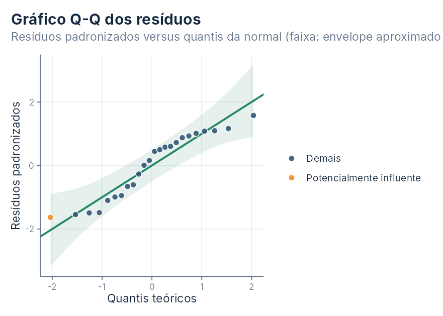
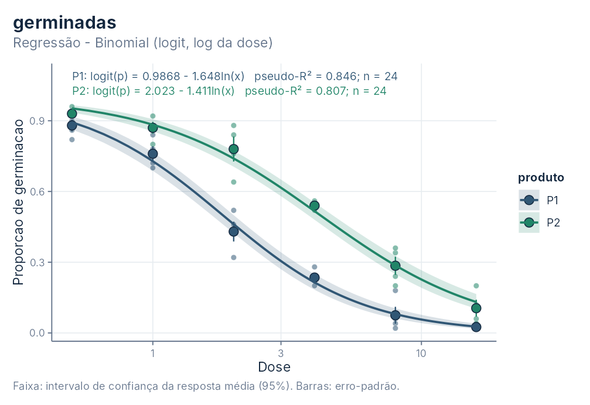
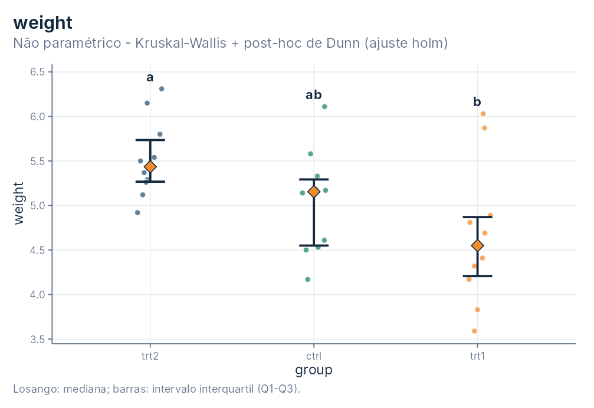
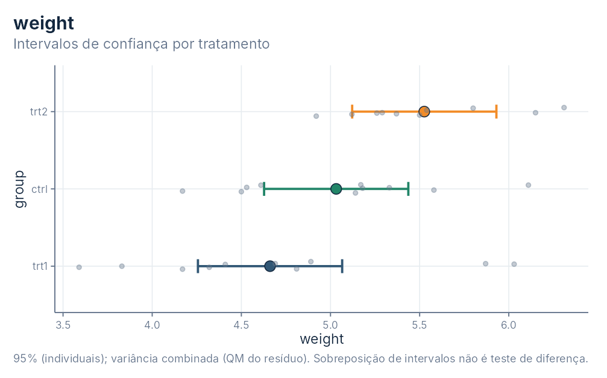
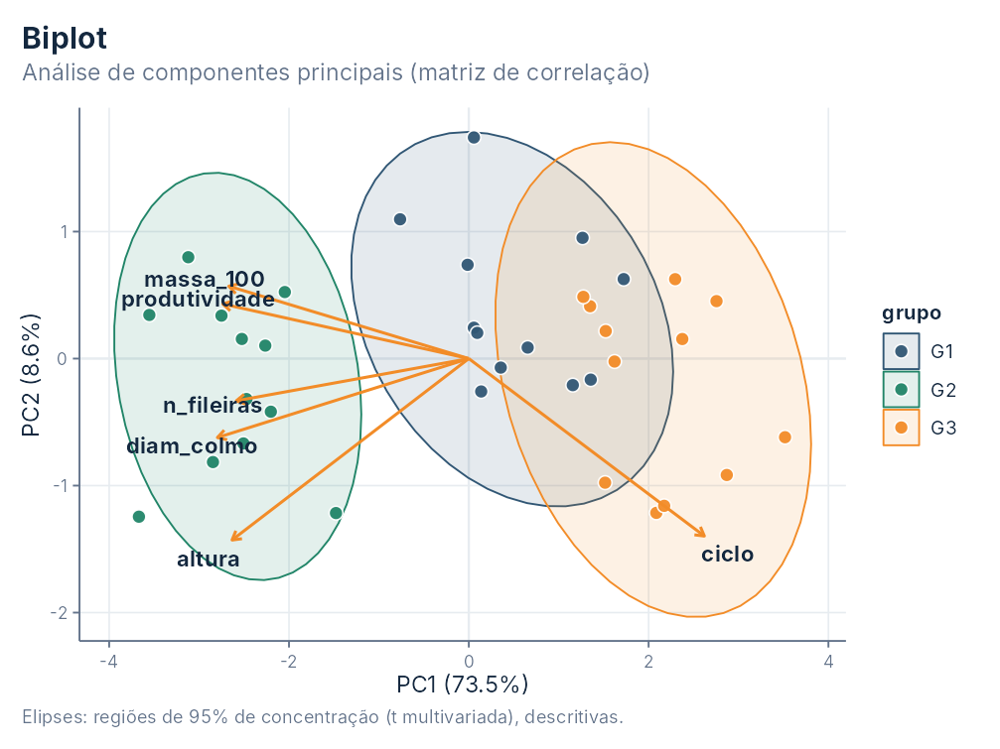

<!-- README.md is generated from README.Rmd. Please edit this file. -->
<!-- Figures are produced by the package itself: Rscript data-raw/make_figures.R -->
<p align="center">

</p>
<h1 align="center">
caagro
</h1>
<p align="center">
<b>Ciência Aplicada em Análises do Agro</b><br> Plataforma de análise
estatística para experimentação agrícola — em R e em aplicativos Shiny
</p>
<p align="center">

= 4.1">


</p>

------------------------------------------------------------------------

O **caagro** reúne, em um único pacote, os métodos estatísticos mais
usados na experimentação agrícola: ANOVA em DIC, DBC e fatoriais,
comparações múltiplas, diagnóstico de resíduos, regressão linear, não
linear e binomial, testes não paramétricos, intervalos de confiança,
análises multivariadas e exploratórias.

Cada análise pode ser feita **sem escrever código** (aplicativos Shiny)
ou **por script** — e as duas formas chamam exatamente as mesmas
funções, de modo que todo resultado obtido na interface pode ser
reproduzido em R.

<p align="center">

</p>

## Destaques

|                         |                                                                                                                                                                                                                                                                                                                       |
|-------------------------|-----------------------------------------------------------------------------------------------------------------------------------------------------------------------------------------------------------------------------------------------------------------------------------------------------------------------|
| **Rigor estatístico**   | Modelos corretos para cada delineamento (o DBC nunca é analisado como DIC), ANOVA convencional de Fisher como padrão (somas de quadrados sequenciais, como `aov`; tipos II/III opcionais), médias marginais estimadas para dados desbalanceados, comparação com implementações de referência em testes automatizados. |
| **Transparência**       | Nenhuma observação é removida automaticamente; exclusões são explícitas e registradas. Falhas de convergência são relatadas, nunca mascaradas.                                                                                                                                                                        |
| **Didática**            | Cada resultado traz três níveis: *Resultado*, *Interpretação* e *Cuidados* (ocultáveis no “modo científico”). Assistente de análise baseado em regras transparentes.                                                                                                                                                  |
| **Gráficos editoriais** | Um único editor gráfico para todos os módulos, cinco temas, exportação re-renderizada em PNG, TIFF, SVG e PDF (300–1200 dpi).                                                                                                                                                                                         |
| **Reprodutibilidade**   | Script R, configuração JSON, versões e sementes exportados junto com relatórios Excel e HTML/Word.                                                                                                                                                                                                                    |
| **Local e privado**     | Tudo roda no seu computador; sem conta, telemetria ou envio de dados.                                                                                                                                                                                                                                                 |

## Instalação

``` r
# a partir do código-fonte (diretório do pacote)
install.packages(c("shiny", "bslib", "ggplot2", "DT", "openxlsx", "readxl",
                   "jsonlite", "mvtnorm", "cluster", "rlang"))
install.packages("caagro_1.1.0.tar.gz", repos = NULL, type = "source")

# recomendados (exportação de alta qualidade e testes)
install.packages(c("ragg", "svglite", "rmarkdown"))
```

## Início rápido

``` r
library(caagro)

run_app()            # aplicação principal com todos os módulos

run_exploratory()    # aplicativos individuais
run_anova()
run_regression()
run_nonparametric()
run_confidence()
run_multivariate()

anQuali(); anQuant(); anIC()   # lançadores legados continuam funcionando
```

Cada aplicativo segue a mesma sequência: **Carregar exemplo** (ou
importar planilha) → escolher as variáveis → **Executar análise**. Os
resultados aparecem em **Análise** (resumo, tabela principal,
comparações e pressupostos), com **Diagnósticos**, **Gráficos** e
**Exportação** em abas próprias. Opções estatísticas avançadas ficam
recolhidas.

| Módulo          | Exemplo incluído                                           | Método padrão                |
|-----------------|------------------------------------------------------------|------------------------------|
| ANOVA           | Produtividade de soja (DIC), ensaio em DBC, fatorial 3 x 3 | ANOVA de Fisher + Tukey a 5% |
| Regressão       | Resposta à dose; germinação x dose (binomial)              | Linear e quadrático          |
| Não paramétrica | Notas de severidade (1 a 9)                                | Kruskal-Wallis + Dunn (Holm) |
| Intervalos      | Peso de plantas (dados reais)                              | IC 95% por tratamento        |
| Multivariada    | 36 genótipos, 6 caracteres                                 | PCA padronizada              |
| Exploratória    | Altura de plantas                                          | Estatística descritiva       |

## Análise paramétrica

``` r
fit <- anova_exp(sim_dbc, response = "produtividade",
                 treatment = "tratamento", block = "bloco")   # DBC
fit                                    # quadro da ANOVA, CV%, médias, efeitos
compare_means(fit, "scott_knott")      # ou "tukey", "snk", "lsd", "dunnett", ...
check_assumptions(fit)                 # Shapiro-Wilk e Bartlett (+ Levene, Cook...)

# fatorial em blocos com somas de quadrados tipo III e efeitos simples
f <- anova_exp(npk, "yield", "N", block = "block", factors = c("P", "K"), ss_type = "III")
compare_means(f, "tukey", factor = "N", by = "P")

mean_test(sleep, "extra", "group", type = "paired", id = "ID")
anova_exp(PlantGrowth, "weight", "group", method = "welch")   # alternativa
```

<p align="center">


</p>
<p align="center">

</p>
<p align="center">

</p>

## Regressão

Modelos disponíveis: linear, quadrático, cúbico, logarítmico,
exponencial, potência, logístico (3 e 4 parâmetros), Gompertz,
Michaelis-Menten, assintótico, Mitscherlich, log-logístico
(dose-resposta), linear-platô e binomial (logit, em x ou em ln x).

``` r
r <- fit_regression(sim_dose, x = "dose", y = "produtividade",
                    model = c("linear", "quadratic", "linear_plateau", "mitscherlich"),
                    group = "cultivar", band = "confidence")
result_table(r, "comparison")      # R², pseudo-R², RMSE, AIC, AICc, BIC, pesos de Akaike
result_table(r, "curve_test")      # as curvas dos grupos diferem?
optimum_dose(r, "quadratic", price_ratio = 0.004)   # MET e dose econômica (método delta)

b <- fit_regression(subset(sim_germinacao, dose > 0), "dose", "germinadas",
                    model = "binomial_logdose", trials = "total", group = "produto")
optimum_dose(b)                    # ED50 com IC
```

<p align="center">


</p>
<p align="center">

</p>

## Não paramétrica

``` r
kw <- np_test(PlantGrowth, "weight", "group", test = "kruskal")
np_posthoc(kw, "dunn", p_adjust = "holm")
np_test(dados, "nota", "tratamento", test = "friedman", block = "bloco")
np_test(PlantGrowth, "weight", "group", test = "mood")
np_test(PlantGrowth, "weight", "group", test = "permutation", R = 4999, seed = 1)
```

## Intervalos de confiança

``` r
conf_int(PlantGrowth, "weight", "group_means", group = "group")
conf_int(PlantGrowth, "weight", "variance")
conf_int(subset(PlantGrowth, group != "trt2"), "weight", "diff_means_welch", group = "group")
conf_int(PlantGrowth, "weight", "median", method = "bootstrap", R = 5000, seed = 42)
```

<p align="center">


</p>

## Multivariada

``` r
p <- pca_exp(sim_multivariado, group = "grupo", label = "genotipo")
plot(p, "biplot")
cluster_exp(sim_multivariado, label = "genotipo", method = "ward.D2", k = 3)
cluster_exp(sim_multivariado, method = "kmeans", k = 3, seed = 123)
cor_matrix(sim_multivariado, method = "spearman", p_adjust = "holm")
```

<p align="center">


</p>

## Gráficos personalizáveis

Todos os gráficos usam o mesmo objeto de estilo — o mesmo que o editor
dos aplicativos manipula — e podem ser salvos e recarregados em JSON.

``` r
estilo <- caagro_style(
  theme = "bw", title = "Produtividade de cultivares",
  y = axis_spec(title = "Produtividade", unit = "t/ha", min = 0, decimals = 1),
  legend = legend_spec(position = "bottom"),
  geoms = geom_spec(show_values = TRUE, point_size = 2.5)
)
g <- plot(compare_means(fit, "tukey"), type = "bars", style = estilo)
save_plot(g, "figura1.tiff", width = 17, height = 12, units = "cm", dpi = 600)
style_to_json(estilo, "meu_estilo.json")
```

Temas: *Scientific Light* (padrão), *Scientific Minimal*, *Publication
Black & White*, *Scientific Dark* e *caagro Corporate*.

<p align="center">

</p>

## Funções do pacote

A versão 1.1 reduziu a interface de programação a 41 funções exportadas
(eram 53), agrupando variantes em argumentos:
`anova_exp(method = "welch")`, `compare_means(contrasts = ...)`,
`conf_int(parameter = "group_means")`, `conf_int(method = "bootstrap")`,
`cluster_exp(method = "kmeans")`, `export_script(config = TRUE)`; o
teste de igualdade de curvas é calculado automaticamente por
`fit_regression()` (tabela `curve_test`).

## Exportação e reprodutibilidade

``` r
export_excel(list(fit, compare_means(fit), check_assumptions(fit)), "resultados.xlsx")
export_report(list(fit, compare_means(fit)), "relatorio.html")   # .docx/.pdf com Pandoc
export_script(list(fit, compare_means(fit)), "analise.R", data_file = "dados.xlsx", config = TRUE)
```

Todo resultado é um objeto `caagro_result` com dados usados, método,
fórmula, configurações, tabelas, diagnósticos, advertências, código R e
metadados (versões, data, semente), com métodos `print()`, `summary()`,
`plot()` e `as.data.frame()`.

## Métodos e validação

Os resultados são verificados por testes automatizados contra
implementações de referência: `stats::aov`/`lm`/`glm`/`nls`, `TukeyHSD`,
`car::Anova` (SQ tipo II e III), `car::leveneTest`, `emmeans` (médias
marginais e Dunnett), `rstatix` (Games-Howell e Dunn), `kruskal.test`,
`friedman.test`, `wilcox.test`, `t.test`, `prcomp`, `hclust` e `boot`
(BCa). SNK e Scott-Knott são verificados contra o cálculo manual das
fórmulas originais (Newman, 1939; Keuls, 1952; Scott e Knott, 1974).
Detalhes estão nas vinhetas (`browseVignettes("caagro")`).

## Roadmap

- Modelos mistos (blocos aleatórios, parcelas subdivididas) com
  `nlme`/`lme4`.
- Skillings-Mack para blocos incompletos; PCoA, NMDS e PERMANOVA.
- Modelos de contagem (Poisson, binomial negativa) e quasibinomial.
- Testes de interface ponta a ponta com `shinytest2` e integração
  contínua (hoje os servidores dos módulos são testados com
  `shiny::testServer()`).
- Modo exploratório interativo com `plotly` (opcional).

## Como citar

``` r
citation("caagro")
```

## Licença

MIT © Wilhan Valasco dos Santos. Veja `LICENSE`.

## Autoria e contato

**Wilhan Valasco dos Santos** — autor e mantenedor E-mail:
<wilhanvalasco@hotmail.com> Site:
<https://wilhanvalasco.github.io/meu-site/> LinkedIn:
<https://www.linkedin.com/in/wilhan-valasco/>

Os conjuntos `sim_*` são **simulados** e servem apenas para ilustração;
`PlantGrowth`, `npk`, `warpbreaks` e `sleep` são dados reais do pacote
`datasets` do R.
